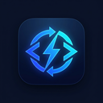

<p align="center">
  
  <h1 align="center">BlinkSync</h1>
  <p align="center">
    <strong>Synchronize verified LeetCode Accepted submissions to your GitHub repository.</strong>
    <br />
    <em>Local-first · Privacy-first · Atomic Git Commits</em>
  </p>
</p>

---

> **Status: engineering scaffold / private alpha.** The GitHub Git Data API path, storage model, UI, README generator, retry queue, and tests are implemented. LeetCode's submission GraphQL operation and page network signatures are undocumented integration contracts and must be verified against live, permitted test accounts before any public release. This repository is not yet Chrome Web Store submission-ready.

## What is implemented

- WXT 0.21.x, TypeScript, Manifest V3, document-start content script scoped to LeetCode problem/contest routes.
- MAIN-world `fetch`/XHR bridge that reports only a submission ID and candidate verdict, plus an ISOLATED-world debounced DOM fallback and manual submission-ID control.
- Background re-fetch and `Accepted` validation using LeetCode `submissionDetails`.
- Explicit source-code transfer consent; automatic sync is off until the user opts in.
- Fine-grained GitHub PAT held in `chrome.storage.session` (never sent to page context).
- Atomic two-file Git Data API commit: source + per-problem README in one commit.
- Remote blob SHA comparison, submission ledger, in-flight de-duplication, branch fast-forward update (`force: false`), and README links for known solution variants.
- Durable IndexedDB retry/contest queue (including submission-ID-only recovery when LeetCode is temporarily offline), manual failed-item retry, optional scheduled release, and bounded local sync history.
- Language extension map, safe path templating, local complexity heuristics, README generation (full problem statement excluded unless explicitly enabled), and opt-in spaced repetition with an in-page review action.
- Popup settings, local health dashboard, and privacy-policy draft.

## Important design choices

1. **Verdict detection is not source retrieval.** The content script observes a candidate ID only. The background fetches `submissionDetails` independently and rejects any response whose status code is not Accepted. It deliberately does not trust Monaco editor contents: the current editor may differ from the source LeetCode actually accepted.
2. **Do not promise an unconditional two-second push.** The primary path is optimized, but multiple GitHub API round trips, service availability, network RTT, rate limiting, and user auth determine end-to-end time. Measure p50/p95 in real runs.
3. **Storage is not a hardware-backed vault.** This build stores a token only in `chrome.storage.session`, which Chrome clears on browser restart, extension reload, or update. It is restricted to trusted extension contexts. Do not add persistent token storage without a distinct disclosure and threat model.
4. **No undocumented API is stable.** LeetCode's GraphQL operation and UI locators are contained in adapters so they can be updated independently.
5. **Complexity is heuristic.** The analyzer recognizes common source patterns but does not parse a full language AST or prove complexity.

## Requirements

- Node.js 22+ required by the current WXT 0.21.5 toolchain.
- npm 10+.
- Vite 6.3.4+ is installed as a WXT peer dependency in the root project.
- Chromium browser for the MAIN-world interception path.
- A GitHub fine-grained personal access token restricted to one repository, with **Contents: Read and write**.
- Signed-in LeetCode session in the browser.

## Run the extension

```bash
npm install  # postinstall runs wxt prepare and generates .wxt types
npm run dev
```

WXT prints the unpacked development directory. Open `chrome://extensions`, enable Developer mode, and load the generated Chrome MV3 development output directory (`.output/chrome-mv3-dev`).

Production build:

```bash
npm run typecheck
npm test
npm run build
npm run zip
npm run size
```

Firefox build (separate QA required):

```bash
npm run build:firefox
```

The build emits a generated `manifest.json` in the output directory (`.output/chrome-mv3`). Do not manually edit the generated manifest; update `wxt.config.ts` instead. A reference manifest is in `docs/manifest.reference.json`.

## Configure

1. Open the BlinkSync extension popup.
2. Enter a repository as `owner/repository` and the target branch (normally `main`). The repository must already have an initial commit/branch.
3. Create a fine-grained PAT scoped to that repository with Contents read/write access. Paste it into the token field. It is kept in session storage only.
4. Save settings and use **Test connection**.
5. Sign in to LeetCode in the same browser profile, submit a solution, and wait for an Accepted verdict.
6. Inspect the repository and the local dashboard.

Default path: `{difficulty}/{problemNumber}-{problemSlug}/solution.{extension}`.
Supported placeholders: `{difficulty}`, `{problemNumber}`, `{problemSlug}`, `{extension}`, `{language}`.

## OAuth status

The scaffold implements PAT authentication only. A secure OAuth option should be delivered through a GitHub App with repository-scoped Contents permission and a serverless token broker, not a client-embedded OAuth secret or an unnecessarily broad `repo` OAuth scope. See `docs/OAUTH.md`. Do not advertise OAuth until that flow is implemented, reviewed, and tested.

## Operational constraints

- LeetCode submission detail retrieval depends on the user's LeetCode session cookies being available to an extension-origin request. Verify this with Chrome stable and the current LeetCode site before release. If the details request is transiently unavailable, the submission ID is held in IndexedDB and revalidated later; no GitHub write occurs without source + Accepted revalidation.
- The observed LeetCode endpoint and GraphQL field names are private/undocumented. Maintain fixtures and an adapter compatibility test.
- The content script's page-world bridge is forgeable by the page. This is expected; the background treats it as an untrusted hint and independently verifies details.
- Chrome alarms may be delayed and are not a real-time scheduler. The IndexedDB queue is durable; do not show a fabricated exact retry countdown. The GitHub PAT remains session-only, so queued writes require reconnection after a browser restart.
- If a GitHub branch moves concurrently, the non-forced ref update should fail rather than overwrite the other push. The queued attempt will re-read the branch and retry.
- Repository paths and remote descriptions are treated as untrusted content. The README generator strips HTML elements and script/style blocks.

## Repo layout

```text
entrypoints/
  background.ts             MV3 service-worker orchestration
  leetcode.content.ts       isolated content script + fallbacks
  leetcode-main-world.ts    page request observer; no extension APIs
  popup/                    settings and connection test
  dashboard/                local health dashboard
src/
  background/               LeetCode, GitHub, storage, sync services
  shared/                   types, validators, path, README, analyzer
tests/                      vitest test suite
docs/                       architecture, error matrix, test plan, release guide
```

## Security and store readiness

Read `docs/PRIVACY.md`, `docs/ERROR-MATRIX.md`, and `docs/STORE-RELEASE.md`. Chrome Web Store submission requires truthful data-use disclosure, an accessible privacy policy, narrow permissions, user consent, support contact details, and store assets.

## License

MIT License. See [LICENSE](LICENSE).
